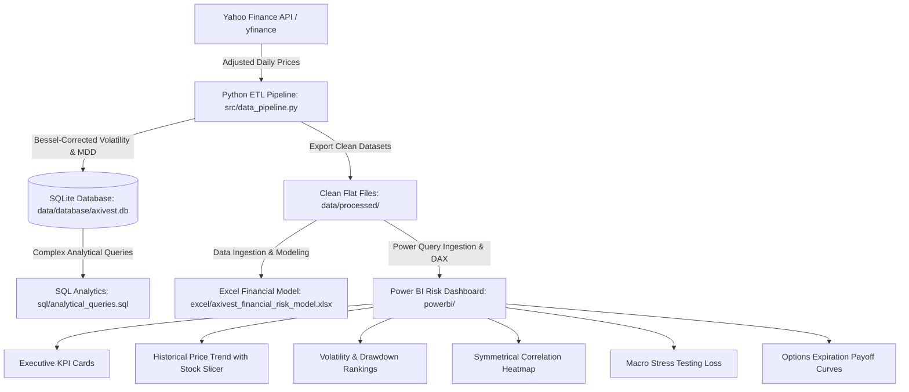

# AXIVEST — Portfolio Risk & Options Intelligence
### *“See the risk. Test the downside.”*

[](./LICENSE)
[](https://www.python.org/)
[](https://www.sqlite.org/)
[](https://powerbi.microsoft.com/)
[](https://www.microsoft.com/excel)

**Author & Developer:** **Kandala Guru Balaji**  
**Program:** B.Tech in Computer Science and Business Systems (3rd Year)  
**Domain Focus:** Financial Data Analytics, Quantitative Risk Modeling & Business Intelligence  

---

## 1. Project Overview & Motivation

In traditional equity investing, retail and institutional participants often focus exclusively on historical price returns while underestimating downside tail risk. A portfolio can appear stable during steady bull markets, only to suffer severe capital destruction during market drawdowns or systemic liquidity crunches.

**AXIVEST** was developed to solve this asymmetry. Designed as an institutional-grade financial analytics system, AXIVEST combines:
1. **Historical Downside Risk Analytics:** Tracking sample-adjusted annualized volatility and peak-to-trough Maximum Drawdowns across 10 leading Indian blue-chip equities and the **NIFTY 50** index benchmark over a two-year historical window (**October 2024 to October 2026**).
2. **Macroeconomic Scenario Stress Testing:** Modeling instantaneous shocks across Mild, Moderate, and Severe macro stress environments on an illustrative **₹100,000** capital base.
3. **Derivatives Intelligence:** Modeling expiration payoff curves and breakeven horizons for multi-leg option strategies (**Bull Call Spread, Long Straddle, Iron Condor**) to evaluate asymmetric risk-reward structures.

---

## 2. Key Features

* 📈 **Interactive Historical Performance Engine:** Normalized rebased index (Base 100 on start date) allowing multi-stock comparison against NIFTY 50 without nominal price scale distortion.
* ⚡ **Sample-Adjusted Volatility Rankings:** Bessel-corrected ($ddof=1$) annual volatility parameterized across 252 Indian market trading days.
* 📉 **Peak-to-Trough Drawdown Tracker:** Exact detection of historical peak dates, trough dates, and drawdown severity (identifying TCS's -52.7% historical drawdown).
* 🟥 **Symmetrical Pairwise Correlation Heatmap:** Full $11 \times 11$ matrix mapping concentration risk and identifying high-diversification asset pairs.
* 🛡️ **Macroeconomic Downside Stress Simulator:** Instantaneous portfolio shock engine evaluating capital preservation across 3 macro environments.
* 🎯 **Options Expiration Payoff Cockpit:** Strike-level payoff architecture with automated breakeven lines and risk/reward boundaries.
* 🌐 **Interactive Vercel Web Dashboard:** Production React & Vite web application featuring an automated Quantitative Investment Verdict Engine (Buy / Hold / Caution), real-time price trend charting with 20/50 SMA overlays, and interactive stress simulators.
* 🗄️ **Relational SQLite Database & Analytical SQL Library:** 11 structured tables with 8 production-grade queries demonstrating window functions, moving averages, and cumulative compounding.
* 📊 **Multi-Tab Excel Financial Risk Model:** Dynamic workbook containing executive summaries, formula-driven scenario models, and formatted tables.

---

## 3. Technology Stack

| Layer | Tool / Technology | Purpose |
| :--- | :--- | :--- |
| **Live Broker Integration** | Upstox API v2 (`historical-candle`, `instruments`) | Live on-demand market data retrieval for 46 flagship stocks + 800+ NSE equities |
| **Data Retrieval & ETL** | Python 3.11, `pandas`, `numpy`, `requests` | Automated historical data extraction, cleaning, and vectorized metric calculations |
| **Relational Database** | SQLite (`axivest.db`), DB Browser for SQLite | Structured schema storage, primary keys, and analytical window queries |
| **Financial Modeling** | Microsoft Excel 365, `openpyxl` | Dynamic formula modeling (`SUMPRODUCT`, `RANK`, `AVERAGE`) & scenario analysis |
| **Interactive Web Application** | React, Vite, Chart.js, Vanilla CSS Glassmorphism | Production interactive web dashboard with Upstox Live Quant Screener deployed on Vercel |
| **Executive BI Dashboard** | Microsoft Power BI Desktop, DAX | Institutional reporting, dynamic slicers, matrix heatmaps, and KPI cards |
| **Deployment & Version Control** | Vercel, Git & GitHub | Serverless zero-config web deployment, CI/CD, and repository tracking |

---

## 4. Asset Universe & Scope

The analytical universe covers 10 blue-chip constituents representing major pillars of the Indian economy, benchmarked against the NIFTY 50 index:

| Asset Name | Ticker (NSE) | Industry Sector | Portfolio Role |
| :--- | :--- | :--- | :--- |
| **Bharti Airtel** | `BHARTIARTL.NS` | Telecommunications | Defensive Growth |
| **HDFC Bank** | `HDFCBANK.NS` | Private Banking | Core Financial Heavyweight |
| **ICICI Bank** | `ICICIBANK.NS` | Private Banking | Core Financial Growth |
| **Infosys** | `INFY.NS` | Information Technology | IT Services & Global Export |
| **ITC** | `ITC.NS` | FMCG & Diversified | Defensive Yield Anchor |
| **Larsen & Toubro (L&T)** | `LT.NS` | Infrastructure & Capex | Capital Goods Proxy |
| **Mahindra & Mahindra (M&M)**| `M&M.NS` | Automobile & Manufacturing | Cyclical Automotive Growth |
| **NTPC** | `NTPC.NS` | Utilities & Energy | Power Infrastructure Stabilizer |
| **Reliance Industries** | `RELIANCE.NS` | Conglomerate / Energy & Retail | Index Heavyweight |
| **TCS** | `TCS.NS` | Information Technology | Premier IT Bellwether |
| **NIFTY 50** | `^NSEI` | Benchmark Index | Systematic Market Baseline |

* **Observation Period:** October 9, 2024 to October 9, 2026 (497 Trading Days | 495 Return Intervals).

---

## 5. End-to-End System Architecture



---

## 6. Mathematical Methodology & Formulas

### 6.1. Daily Return Calculation
$$R_{i,t} = \frac{P_{i,t} - P_{i,t-1}}{P_{i,t-1}}$$

### 6.2. Annualized Volatility
Sample standard deviation ($ddof = 1$) scaled by the square root of 252 Indian market trading sessions:
$$\sigma_{i,\text{ann}} = \sqrt{\frac{1}{N-1}\sum_{t=1}^{N}(R_{i,t} - \bar{R}_i)^2} \times \sqrt{252} \times 100\%$$

### 6.3. Maximum Drawdown (Peak-to-Trough Decline)
$$\text{Peak}_{i,t} = \max_{s \le t} P_{i,s}$$
$$\text{Drawdown}_{i,t} = \frac{P_{i,t} - \text{Peak}_{i,t}}{\text{Peak}_{i,t}} \times 100\%$$
$$\text{MDD}_i = \min_t \text{Drawdown}_{i,t}$$

### 6.4. Macroeconomic Stress Testing
Equal-weighted 10-stock portfolio ($w_i = 10\%$ each) with illustrative starting capital of ₹100,000:
$$R_{\text{portfolio}} = \sum_{i=1}^{10} w_i \times \Delta_i$$
$$\text{Residual Capital} = \text{₹}100,000 \times (1 + R_{\text{portfolio}})$$

### 6.5. Options Expiration Payoff Models
1. **Bull Call Spread (Long 1000C @ ₹50, Short 1100C @ ₹15 | Net Debit = ₹35):**
   $$\Pi_{\text{BCS}}(S_T) = \max(S_T - 1000, 0) - \max(S_T - 1100, 0) - 35$$
   *Max Profit: +₹65 | Max Loss: -₹35 | Breakeven: ₹1,035*
2. **Long Straddle (Long 1000C @ ₹55, Long 1000P @ ₹50 | Net Debit = ₹105):**
   $$\Pi_{\text{Straddle}}(S_T) = \max(S_T - 1000, 0) + \max(1000 - S_T, 0) - 105$$
   *Max Loss: -₹105 | Breakevens: ₹895 and ₹1,105*
3. **Credit Iron Condor (850P/900P Put Spread + 1100C/1150C Call Spread | Net Credit = ₹23):**
   $$\Pi_{\text{IC}}(S_T) = \max(850 - S_T, 0) - \max(900 - S_T, 0) - \max(S_T - 1100, 0) + \max(S_T - 1150, 0) + 23$$
   *Max Profit: +₹23 | Max Loss: -₹27 | Breakevens: ₹877 and ₹1,123*

---

## 7. Key Analytical Findings

| Asset Name | Annualized Volatility | Maximum Drawdown | Peak Date | Trough Date | Risk Characterization |
| :--- | :---: | :---: | :---: | :---: | :--- |
| **Infosys** | **28.20%** | -48.17% | 2024-12-13 | 2026-07-01 | Highest volatility equity in universe |
| **M&M** | **28.05%** | -26.89% | 2026-01-02 | 2026-10-08 | High cyclical volatility; moderate drawdown |
| **TCS** | **25.10%** | **-52.68%** | 2024-12-13 | 2026-07-01 | **Worst peak-to-trough drawdown** |
| **L&T** | 24.63% | -24.35% | 2026-02-23 | 2026-03-23 | Moderate-high industrial beta |
| **NTPC** | 21.27% | -29.67% | 2024-10-15 | 2025-01-13 | High diversification against IT ($r=0.0465$) |
| **Bharti Airtel** | 20.90% | -18.77% | 2025-11-21 | 2026-05-12 | Resilient drawdown relative to tech sector |
| **Reliance** | 20.79% | -26.33% | 2026-01-02 | 2026-10-01 | Index stabilizer |
| **HDFC Bank** | 19.81% | -31.04% | 2025-07-30 | 2026-09-09 | Strongest index correlation ($r=0.7091$) |
| **ITC** | 19.50% | -42.37% | 2024-10-15 | 2026-10-08 | Low daily volatility; prolonged drawdown |
| **ICICI Bank** | **18.48%** | **-18.37%** | 2025-07-23 | 2026-03-30 | **Lowest equity volatility and shallowest drawdown** |
| **NIFTY 50** | **13.13%** | **-15.56%** | 2026-01-02 | 2026-10-08 | **Diversified market benchmark baseline** |

### Macro Stress Impact Summary:
* **Mild Stress Scenario:** Portfolio Return: **-4.40%** | Estimated Capital: **₹95,600**
* **Moderate Stress Scenario:** Portfolio Return: **-10.70%** | Estimated Capital: **₹89,300**
* **Severe Stress Scenario:** Portfolio Return: **-22.70%** | Estimated Capital: **₹77,300**

---

## 8. Relational Database Design & SQL Examples

The SQLite database (`axivest.db`) is structured with 11 relational tables.

### Example SQL Query: Asset Risk Ranking via Window Functions
```sql
SELECT 
    v.stock,
    v.annualized_volatility_pct,
    RANK() OVER (ORDER BY v.annualized_volatility_pct DESC) AS volatility_rank,
    m.max_drawdown_pct,
    RANK() OVER (ORDER BY m.max_drawdown_pct ASC) AS drawdown_severity_rank,
    m.peak_date,
    m.trough_date
FROM annualized_volatility v
JOIN maximum_drawdown m ON v.stock = m.stock
ORDER BY v.annualized_volatility_pct DESC;
```

### Example SQL Query: Top Diversification Pairs
```sql
SELECT 
    stock_1, 
    stock_2, 
    correlation
FROM stock_correlations_pairwise
ORDER BY correlation ASC
LIMIT 5;
```

---

## 9. Repository Structure

```
AXIVEST/
├── README.md                      # Primary project portfolio documentation
├── LICENSE                        # MIT Open-Source License (Kandala Guru Balaji)
├── requirements.txt               # Verified Python dependencies
├── .gitignore                     # Git tracking exclusions
├── notebooks/
│   └── axivest_pipeline.ipynb     # Reproducible 10-step Google Colab notebook
├── src/
│   ├── data_pipeline.py           # Core ETL, risk math & SQLite database population
│   ├── build_notebook.py          # Script generating reproducible Colab notebook
│   └── build_excel_model.py       # Script generating 5-tab Excel financial workbook
├── sql/
│   ├── schema.sql                 # Formal SQLite DDL schema with constraints & indexes
│   └── analytical_queries.sql     # 8 documented analytical SQL queries
├── data/
│   ├── processed/                 # Clean, verified CSV exports for BI & Excel
│   └── database/
│       └── axivest.db             # Relational SQLite database
├── excel/
│   └── axivest_financial_risk_model.xlsx # 5-tab institutional financial model
├── powerbi/
│   ├── PowerBI_Design_Guide.md    # Click-by-click dashboard construction guide
│   └── DAX_Measures.dax           # Production DAX formulas for KPI cards & slicers
├── docs/
│   ├── financial_methodology.md   # Mathematical audit, disclosures & proofs
│   └── data_dictionary.md         # Field-by-field schema & metadata reference
├── web/                           # Production Interactive Web Dashboard (React & Vite)
│   ├── src/                       # React components, charts, and financial data JSONs
│   ├── package.json               # Node.js dependencies
│   ├── vercel.json                # Vercel deployment configuration
│   └── dist/                      # Pre-compiled static production bundle
└── screenshots/
    └── reference_dashboard.png    # Reference dashboard benchmark
```

---

## 10. How to Reproduce & Deploy This Project

### 1. Clone the Repository
```bash
git clone https://github.com/guru-balaji/AXIVEST.git
cd AXIVEST
```

### 2. Set Up Python Environment
```bash
python -m venv venv
# Windows:
venv\Scripts\activate
# Mac/Linux:
source venv/bin/activate

pip install -r requirements.txt
```

### 3. Run Data Pipeline & Populate SQLite Database
```bash
python src/data_pipeline.py
```
*Outputs all 11 verified CSV datasets to `data/processed/` and populates `data/database/axivest.db`.*

### 4. Generate Financial Excel Model
```bash
python src/build_excel_model.py
```
*Generates `excel/axivest_financial_risk_model.xlsx` with formulas and formatting.*

### 5. Launch the Web Dashboard Locally
```bash
cd web
npm install
npm run dev
```
*Starts local Vite dev server at `http://localhost:5173`.*

### 6. Deploy Instantly to Vercel
You can deploy AXIVEST directly to Vercel in 60 seconds:
* **Option A (GitHub Integration):** Push the repo to your GitHub $\rightarrow$ Go to [vercel.com/new](https://vercel.com/new) $\rightarrow$ Import your `AXIVEST` repo $\rightarrow$ Click **Deploy**. Vercel will automatically detect `vercel.json` and build the application.
* **Option B (Vercel CLI):**
  ```bash
  cd web
  npx vercel
  ```

### 7. Build or Refresh Power BI Desktop Report
Follow the click-by-click instructions in [PowerBI_Design_Guide.md](./powerbi/PowerBI_Design_Guide.md) to load the CSVs, import [DAX_Measures.dax](./powerbi/DAX_Measures.dax), unpivot `daily_prices`, and configure the interactive visuals.

---

## 11. Disclosures & Educational Disclaimer

> [!IMPORTANT]
> **Educational & Academic Disclaimer:**  
> This project is developed strictly for educational, academic, and technical demonstration purposes by **Kandala Guru Balaji** as part of a computer science and business systems curriculum. All market stress scenarios and option expiration payoffs are theoretical mathematical simulations. Nothing contained in this project constitutes investment advice, financial planning, trading recommendations, or performance guarantees.

---

## 12. License & Attribution

This project is licensed under the **MIT License** — see the [LICENSE](./LICENSE) file for details.  
*Attribution:* Market retrieval patterns adapted from the reference repository `Stock_Market_Performance_Dashboard_and_Risk_Analysis` by Vinay Kumar (2025). The quantitative drawdown models, macro stress testing engine, derivatives intelligence payoff architecture, SQLite relational design, and Power BI unpivoted slicer design represent original engineering by **Kandala Guru Balaji**.
